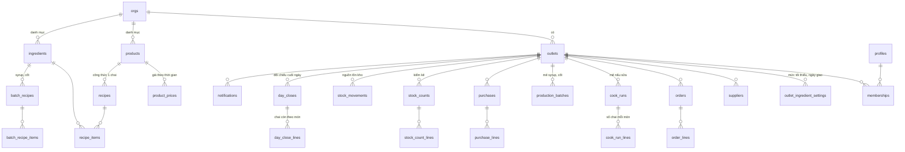

# Thiết kế cơ sở dữ liệu · Kho BaBa bản 1

Phiên bản 1.2 · 09/11/2026 (đã đối chiếu với thiết kế màn hình và user story) · PostgreSQL trên Supabase (project `BaBa`, vùng ap-southeast-1)

Tài liệu này mô tả các bảng cần cho bản 1 theo đúng 28 màn hình đã thiết kế, và cách mỗi bảng được chuẩn bị sẵn cho các tính năng bản sau (phí 1.000 đ/chai, đối tác, nhà sáng lập xem toàn mạng lưới). Phần cuối là thứ tự tạo bảng và dữ liệu nạp sẵn.

---

## 1. Nguyên tắc

| Nguyên tắc | Vì sao | Thể hiện trong lược đồ |
| --- | --- | --- |
| **Đa cơ sở từ ngày đầu** | Mỗi cơ sở kinh doanh riêng, nhà sáng lập xem được tất cả | Mọi bảng nghiệp vụ có `outlet_id`; danh mục chung có `org_id` |
| **Sổ cái nối thêm, không sửa đè** | Đối chiếu cuối ngày chỉ có giá trị khi bản ghi gốc không bị sửa | Đơn sai thì tạo đơn đảo (`reversal_of`), kiểm kê tạo bản ghi điều chỉnh; không có `DELETE` cho người dùng |
| **Danh mục có phiên bản** | Đổi giá hay công thức không được làm sai báo cáo cũ | `product_prices`, `recipes` có `valid_from`; dòng đơn lưu `unit_price` tại thời điểm bán |
| **Tồn kho tính từ biến động** | Một nguồn sự thật, không có cột `stock` phải đồng bộ | `stock_movements` là nguồn, `v_stock_balance` là view; snapshot ngày chỉ để báo cáo nhanh |
| **Chống ghi trùng khi mất mạng** | App PWA gửi lại khi có mạng | Mọi bản ghi do máy tạo có `client_id uuid UNIQUE` |
| **Quyền kiểm tra ở tầng dữ liệu** | Giao diện không phải chỗ chặn | Row Level Security theo `memberships`; admin tổ chức thấy mọi cơ sở |

Quy ước chung cho mọi bảng: khóa chính `id uuid default gen_random_uuid()`, `created_at timestamptz default now()`, `created_by uuid references profiles(id)`, `updated_at timestamptz` (trigger tự cập nhật), và `server_seq bigint generated always as identity` trên các bảng nghiệp vụ để app kéo thay đổi tăng dần khi đồng bộ ("cho tôi mọi thứ có `server_seq` lớn hơn X"). Tiền là `integer` VND. Số lượng là `numeric(12,2)` theo đơn vị chuẩn của vật tư (g, ml, cái). Ngày nghiệp vụ `business_date date` lưu riêng theo múi giờ Asia/Ho_Chi_Minh, vì một ca có thể vắt qua nửa đêm UTC.

---

## 2. Sơ đồ quan hệ



---

## 3. Bảng theo nhóm

### 3.1 Tổ chức, người dùng, cơ sở (màn A01–A03, G01)

**`orgs`** — tổ chức. Bản 1 có đúng một dòng: BaBa.

| Cột | Kiểu | Ghi chú |
| --- | --- | --- |
| id | uuid PK | |
| name | text | "Sữa lành từ BaBa" |
| settings | jsonb | múi giờ, định dạng tiền, cờ tính năng |

**`profiles`** — hồ sơ người dùng, 1–1 với `auth.users` của Supabase (đăng nhập email + mã 6 số dùng Supabase Auth, không tự lưu mật khẩu).

| Cột | Kiểu | Ghi chú |
| --- | --- | --- |
| id | uuid PK, FK auth.users | |
| email | text UNIQUE | |
| full_name | text | hiện trên G01 |
| last_outlet_id | uuid | cơ sở mở lần cuối, để vào thẳng A04 |

**`org_memberships`** — vai trò cấp tổ chức. Bản 1 có hai dòng `admin` cho mr.tungvx@gmail.com và troon.org@gmail.com (gán bằng trigger khi họ đăng nhập lần đầu).

| Cột | Kiểu | Ghi chú |
| --- | --- | --- |
| user_id, org_id | uuid | UNIQUE cặp |
| role | text | `admin` (toàn quyền) · sẵn `founder`, `ops`, `finance` cho bản sau |
| status | text | `active`, `removed` |

**`outlets`** — cơ sở. A03 liệt kê các cơ sở người dùng là thành viên.

| Cột | Kiểu | Ghi chú |
| --- | --- | --- |
| id, org_id | uuid | |
| name | text | "Quầy Hồng Gai" |
| model | text | `M1_cart`, `M2_street`, `M2_shop`, `M3_seat`, `M3_experience`, `GARDEN` |
| address, lat, lng | text, numeric | lat/lng để bản sau kiểm tra bán kính bảo vệ |
| status | text | `preparing`, `active`, `paused`, `closed` (chưa hiện trên UI bản 1) |
| opened_at | date | |
| timezone | text | mặc định `Asia/Ho_Chi_Minh`; để sẵn cho điểm bán ngoài múi giờ |
| settings | jsonb | cài đặt riêng của cơ sở, ví dụ `allow_negative_bottles` (cho bán khi sổ ghi hết chai) |
| price_list_id | uuid | bảng giá áp dụng, mặc định bảng `default` |
| currency | text | mặc định `VND` |

**`memberships`** — ai thuộc cơ sở nào, vai trò gì. Đây là bảng RLS dựa vào.

| Cột | Kiểu | Ghi chú |
| --- | --- | --- |
| user_id, outlet_id | uuid | UNIQUE (user_id, outlet_id) |
| role | text | `owner` (chủ cơ sở), `staff` (nhân viên) |
| status | text | `active`, `invited`, `removed` |
| invited_email | text | khi mời người chưa có tài khoản |

Một người có thể là thành viên nhiều cơ sở với vai trò khác nhau (Hà là `owner` ở quầy, `staff` ở xe của người thân). A03 liệt kê theo bảng này.

### 3.2 Danh mục trung tâm (BaBa quản, cơ sở dùng)

**`ingredients`** — vật tư: nguyên liệu, phụ gia, bán thành phẩm tự làm, bao bì. D01 chia nhóm theo `group`.

| Cột | Kiểu | Ghi chú |
| --- | --- | --- |
| id, org_id | uuid | |
| code | text UNIQUE theo org | `dau_do`, `syrup`, `chai_330`, `card_ban_co_biet` |
| name | text | |
| group | text | `main` nguyên liệu chính · `additive` phụ gia · `made` tự làm · `packaging` bao bì |
| unit | text | đơn vị kho và công thức: `g`, `ml`, `cai` |
| purchase_unit, purchase_factor | text, numeric | đơn vị hay mua và hệ số đổi: mua `kg` → ×1000 ra `g`; thùng chai 50 cái → ×50. D03 cho nhập theo đơn vị mua |
| kind | text | `purchased` mua vào · `made` tự làm |
| shelf_days | int | cơm dừa 1, cốt 7, syrup 14; null = không theo dõi hạn |
| default_min_qty | numeric | mức tối thiểu mặc định BaBa đề xuất |
| default_lead_days | int | null = mua ngay được |
| storage_note | text | hiện ở D02 |
| status | text | `active`, `retired` |

**`products`** — 12 món sữa. B01 vẽ lưới từ bảng này.

| Cột | Kiểu | Ghi chú |
| --- | --- | --- |
| id, org_id | uuid | |
| code | text | `md`, `mv`, `tcc`… |
| name, short_name | text | "Mầm Đỏ Hồng Hào" / "Đỏ Hồng Hào" |
| line | text | `xanh`, `sang`, `lanh`, `tre` |
| color | text | mã màu nhận diện |
| image_url | text | ảnh chai thật, null thì app vẽ hình mặc định |
| has_caffeine | boolean | |
| kind | text | `milk_bottle` (bản 1). Sẵn giá trị `milk_hot`, `meal_set`, `bakery`, `ticket`, `class`, `goods` |
| yield_per_jar | numeric | chai mỗi cối xay: 6, bắp 5 (C04 dùng) |
| sort_order | int | |
| status | text | |

**`outlet_menu`** — cơ sở bật món nào. B01, C01, D04 chỉ hiện món đã bật. Xe 4 món không phải nhìn 12 ô.

| Cột | Kiểu | Ghi chú |
| --- | --- | --- |
| outlet_id, product_id | uuid | UNIQUE cặp |
| enabled | boolean | |
| sort_order | int | cơ sở tự xếp thứ tự ô |

**`price_lists`** và **`product_prices`** — giá niêm yết theo thời gian. Bản 1 có một bảng giá `default` cho mọi cơ sở. Bản sau thêm bảng giá riêng cho ly tại chỗ hoặc theo mô hình (`applies_to_models`), cơ sở trỏ `outlets.price_list_id`.

| Cột | Kiểu | Ghi chú |
| --- | --- | --- |
| product_id, price_list_id | uuid | |
| price_vnd | int | |
| valid_from, valid_to | date | `valid_to` null = đang hiệu lực. Ràng buộc không chồng khoảng (exclusion constraint trên daterange) |

**`recipes`** và **`recipe_items`** — định lượng cho 1 chai 330 ml, có phiên bản.

| recipes | | recipe_items | |
| --- | --- | --- | --- |
| product_id | uuid | recipe_id | uuid |
| version | int | ingredient_id | uuid |
| valid_from, valid_to | date | qty | numeric |
| status | `approved`, `draft`, `retired` | | |

Bao bì (chai, nhãn, card) **không** nằm trong công thức. Mỗi chai dùng 1 bộ bao bì theo bảng `packaging_rules (org_id, product_kind, ingredient_id, qty_per_unit, consume_at)`. `consume_at = 'cook'` cho chai, nắp, nhãn, card (chai được rót và dán ngay lúc nấu, nên trừ lúc ghi nấu); `consume_at = 'sale'` dành cho ly, ống hút, túi của ly xay nóng tại chỗ ở bản sau. Tách riêng để đổi loại chai hay thêm túi không phải sửa 12 công thức.

**`batch_recipes`** và **`batch_recipe_items`** — mẻ bán thành phẩm (C03).

| Cột | Kiểu | Ghi chú |
| --- | --- | --- |
| output_ingredient_id | uuid | `syrup` hoặc `cot` |
| output_qty | numeric | 1000 ml / 1200 ml |
| items | | thốt nốt 375 g, phèn 250 g, nhài 5 g / cà phê 200 g |
| version, valid_from | | |

**`model_default_menu`** — `(org_id, model, product_id)`: món bật sẵn cho cơ sở mới theo mô hình (xe lưu động: 4 món gợi ý; takeaway: 12 món). Chỉ dùng lúc tạo cơ sở.

**`sweetness_levels`** — 0 / 10 / 20 ml syrup. Bản 1 chưa ghi theo đơn; giữ bảng để bản sau bật mà không đổi lược đồ (`order_lines.sweetness_level_id` để null).

### 3.3 Cài đặt kho theo cơ sở (màn D01, D02, F02)

**`suppliers`** — nhà cung cấp của từng cơ sở.

| Cột | Kiểu | Ghi chú |
| --- | --- | --- |
| outlet_id | uuid | |
| name, phone, note | text | "Hạt Việt", "Chợ Hạ Long" |

**`outlet_ingredient_settings`** — mỗi cơ sở tự chỉnh mức tối thiểu, ngày giao, nhà cung cấp (D02). Không có dòng thì dùng mặc định trong `ingredients`.

| Cột | Kiểu | Ghi chú |
| --- | --- | --- |
| outlet_id, ingredient_id | uuid | UNIQUE cặp |
| min_qty | numeric | |
| lead_days | int | null = mua ngay được |
| supplier_id | uuid | gom nhắc theo nhà cung cấp |
| notify_email | boolean | |
| enabled | boolean | tắt vật tư cơ sở không dùng |
| on_order_until | date | nút "Đã đặt, đang về" ở D02 đặt = hôm nay + lead_days; tới ngày đó cron không nhắc, D01 hiện nhãn "Đang về" |

**`notification_settings`** — theo cơ sở: giờ gửi email nhắc đặt hàng (mặc định 06:00), giờ nhắc đối chiếu (21:00), email người nhận.

### 3.4 Bán hàng (màn B01, B02)

**`orders`**

| Cột | Kiểu | Ghi chú |
| --- | --- | --- |
| id, outlet_id | uuid | |
| client_id | uuid UNIQUE | chống trùng khi gửi lại |
| seq_in_day | int | "Đơn 24" trên B02, tính theo (outlet, business_date) |
| business_date | date | |
| placed_at | timestamptz | |
| channel | text | `counter` bấm tay (bản 1) · `voice` · `aggregate` gộp cuối ngày |
| status | text | `active`, `reversed` |
| reversal_of | uuid | đơn đảo trỏ về đơn gốc; đơn gốc đổi `status = reversed` |
| reversal_reason | text | |
| is_gift | boolean | đánh dấu tặng từ B02 → dòng đơn `unit_price = 0`, vẫn trừ chai |
| total_vnd | int | cộng từ dòng, lưu lại để báo cáo nhanh |
| payment_method | text | null ở bản 1; sẵn `cash`, `transfer` |
| note | text | |

**`order_lines`**

| Cột | Kiểu | Ghi chú |
| --- | --- | --- |
| order_id, product_id | uuid | |
| qty | int | |
| unit_price_vnd | int | giá tại thời điểm bán |
| recipe_id | uuid | phiên bản công thức đang hiệu lực |
| sweetness_level_id | uuid | null ở bản 1 |
| line_total_vnd | int | |

Ở bản 1, **lưu đơn không trừ vật tư nào**: nguyên liệu và bao bì đều đã trừ lúc ghi nấu (xem 3.5), vì chai bán ra là chai đã nấu và đóng sẵn. Đơn chỉ làm giảm số chai trên quầy (3.7). Hàm `fn_post_order` vẫn gọi `packaging_rules` với `consume_at = 'sale'` để bản sau bán ly tại chỗ trừ ly, ống hút mà không đổi code.

### 3.5 Nấu và sản xuất (màn C01–C04)

**`cook_plans`** và **`cook_plan_lines`** — kế hoạch nấu (C01): `outlet_id, plan_date, kind (next_day|extra_today), status (draft|cooked)`; dòng: `product_id, planned_qty`. Một ngày có thể có nhiều kế hoạch (nấu chính và nấu thêm). Kế hoạch chỉ để tính nguyên liệu; không đụng kho.

**`cook_runs`** và **`cook_run_lines`** — mẻ nấu thật (nút "Ghi đã nấu").

| cook_runs | | cook_run_lines | |
| --- | --- | --- | --- |
| outlet_id, client_id | | cook_run_id | |
| business_date | ngày chai được bán | product_id | |
| cooked_at | | qty | số chai thật ra lò |
| plan_id | null nếu nấu không kế hoạch | recipe_id | phiên bản dùng để trừ kho |
| note | | | |

Hàm `fn_post_cook_run` tạo `stock_movements` âm cho từng nguyên liệu = Σ(qty × recipe_items.qty) và cho bao bì theo `packaging_rules` có `consume_at = 'cook'` (reason `cook_packaging`), rồi cộng chai vào tồn thành phẩm (xem 3.7). Ghi nhầm mẻ nấu: hoàn tác được trong 10 phút sau khi ghi nếu chưa có đơn nào trong ngày nghiệp vụ đó (`fn_reverse_cook_run`); quá đó thì sửa bằng kiểm kê nguyên liệu và đếm chai cuối ngày.

**`production_batches`** — mẻ syrup, cốt (C03).

| Cột | Kiểu | Ghi chú |
| --- | --- | --- |
| outlet_id, client_id | | |
| batch_recipe_id | uuid | |
| batch_count | numeric | số mẻ, cho phép 0.5 |
| produced_at | timestamptz | |
| expires_at | date | = produced_at + shelf_days |

Hàm `fn_post_batch` tạo movement âm cho nguyên liệu và dương cho vật tư đầu ra, kèm `lot_id = production_batches.id` để cảnh báo hạn.

### 3.6 Kho (màn D01–D05)

**`purchases`** và **`purchase_lines`** — nhập hàng (D03).

| purchases | | purchase_lines | |
| --- | --- | --- | --- |
| outlet_id, client_id | | purchase_id | |
| supplier_id | | ingredient_id | |
| purchased_at | | qty | |
| total_vnd | | unit_cost_vnd | tùy chọn, để tính giá vốn sau |
| receipt_url | ảnh hóa đơn (Storage) | expires_at | tùy chọn |
| note | | | |

**`stock_counts`** và **`stock_count_lines`** — kiểm kê (D05).

| Cột | Kiểu | Ghi chú |
| --- | --- | --- |
| outlet_id, counted_at, counted_by | | |
| lines: ingredient_id, qty_book, qty_actual, reason | | `reason`: `shrink`, `spoiled`, `purchase_missed`, `cook_wrong`, `other` |

Hàm `fn_post_count` tạo movement `count_adjust` = qty_actual − qty_book. Số sổ không bị sửa, chỉ có bản ghi điều chỉnh.

**`stock_movements`** — bảng nguồn của tồn kho nguyên liệu.

| Cột | Kiểu | Ghi chú |
| --- | --- | --- |
| id, outlet_id, ingredient_id | | |
| qty_delta | numeric | dương nhập, âm xuất |
| reason | text | `purchase`, `cook`, `cook_packaging`, `batch_in`, `batch_use`, `sale_packaging`, `count_adjust`, `waste` |
| ref_table, ref_id | text, uuid | trỏ về bản ghi gốc |
| business_date | date | |
| lot_id | uuid | cho vật tư có hạn |
| unit_cost_vnd | int | null nếu không biết |

Chỉ các hàm `fn_post_*` được ghi vào bảng này (policy: không cho client INSERT trực tiếp).

**`v_stock_balance`** (view) — mỗi (outlet, ingredient): `qty_on_hand`, `min_qty`, `lead_days`, `avg_daily_use_14d`, `days_of_cover = qty_on_hand / avg_daily_use_14d`, `needs_order = days_of_cover <= coalesce(lead_days, 0) OR qty_on_hand < min_qty`, `nearest_expiry`. D01 đọc thẳng view này. Khi dữ liệu lớn (bản 2), thêm bảng `stock_balances_daily` do cron tính mỗi đêm và view chỉ cộng movement từ snapshot gần nhất.

### 3.7 Tồn chai thành phẩm (màn D04, A04, ô "còn N" ở B01)

Không lưu cột tồn chai. View **`v_bottles_on_hand`** tính theo (outlet, product, business_date):

```
còn = tồn qua từ ngày trước
    + Σ cook_run_lines.qty (business_date)
    − Σ order_lines.qty của đơn active (business_date)
    − day_close_lines.gift_qty − day_close_lines.waste_qty (nếu ngày đã chốt)
```

"Tồn qua" lấy từ `day_close_lines.counted_left` của ngày chốt gần nhất; ngày chưa chốt thì tồn qua = số tính được của hôm trước. Cách này khớp với quyết định "chai còn chuyển sang hôm sau".

### 3.8 Đối chiếu cuối ngày (màn E01–E03)

**`day_closes`** — một dòng mỗi (outlet, business_date).

| Cột | Kiểu | Ghi chú |
| --- | --- | --- |
| outlet_id, business_date, shift_no | | UNIQUE bộ ba; bản 1 luôn `shift_no = 1`. Quán lớn bản sau chốt theo ca mà không đổi bảng |
| status | text | `open`, `closed` |
| cash_counted_vnd | int | E02 |
| transfer_counted_vnd | int | E02 |
| revenue_by_orders_vnd | int | tổng đơn active, tính lúc chốt |
| bottles_by_orders | int | Σ qty đơn active, **kể cả đơn tặng**; doanh thu thì không tính đơn tặng |
| bottles_out | int | nấu + tồn qua − còn |
| diff_bottles | int | bottles_out − gift − waste − bottles_by_orders |
| diff_money_vnd | int | (cash + transfer) − revenue_by_orders |
| money_diff_reason | text | |
| supersedes | uuid | trỏ về bản chốt cũ khi chốt lại; bản cũ không sửa |
| closed_at, closed_by | | |

**`day_close_lines`** — theo món: `product_id, cooked_qty, carried_qty, sold_qty, counted_left, gift_qty, waste_qty`. `gift_qty` là chai tặng **chưa ghi thành đơn**; chai tặng đã ghi qua B02 (đơn `is_gift`) đã nằm trong `sold_qty` và `bottles_by_orders`, không cộng lại vào đây, nếu không sẽ trừ hai lần. Nếu bản sau cần ghi hủy giữa ngày thì thêm bảng `waste_logs`, không đổi bảng này.

Chốt ngày là bất biến: muốn sửa thì tạo `day_closes` mới với `supersedes = id cũ`.

### 3.9 Báo cáo, thông báo, lịch sử (màn F01–F03)

**Doanh thu (F01)** đọc từ view `v_daily_sales` (outlet, business_date, bottles, revenue, orders_count). Giới hạn "nhân viên chỉ xem hôm nay" ở bản 1 thực hiện ở giao diện; bản sau nếu cần chặt hơn thì chuyển view thành hàm `security definer` có kiểm tra vai trò. Kèm `v_sales_by_product` theo tháng. Khi cần nhanh hơn thì chuyển hai view thành materialized view làm mới theo giờ.

**`notifications`** — mỗi dòng là một thẻ trên F02.

| Cột | Kiểu | Ghi chú |
| --- | --- | --- |
| outlet_id | uuid | |
| kind | text | `reorder`, `expiry`, `day_close_missing`, `count_diff`, `invite` |
| severity | text | `info`, `warn`, `danger`, `ok` |
| title, body | text | |
| link | text | đường dẫn trong app |
| dedupe_key | text UNIQUE | ví dụ `reorder:dau_do:2026-11-09` để không gửi lặp |
| emailed_at | timestamptz | |

**`notification_reads`** — `(notification_id, user_id, read_at)`. Trạng thái đã đọc theo từng người, vì một cơ sở có nhiều người dùng.

**`push_subscriptions`** — `(user_id, endpoint, p256dh, auth, created_at)`: đăng ký thông báo đẩy của trình duyệt khi người dùng bật ở F02. Bản 1 chỉ lưu; gửi đẩy bật ở bản 1.1.

Tạo bởi `pg_cron` chạy 06:00 mỗi ngày: quét `v_stock_balance` → tạo dòng `reorder`/`expiry` → gọi Edge Function `send-digest-email` gửi một email gom theo nhà cung cấp cho người có `notify_email`.

**Lịch sử (F03)** là view **`v_activity`** hợp nhất `orders`, `cook_runs`, `production_batches`, `purchases`, `stock_counts`, `day_closes` thành (outlet_id, at, kind, title, detail, amount_vnd, actor). Không có bảng riêng, nên không thể lệch với dữ liệu gốc.

**`audit_log`** — bản ghi kỹ thuật ai làm gì (trigger trên các bảng nghiệp vụ): `actor_id, table_name, row_id, action, old_row, new_row, at`. Không hiện trên UI bản 1.

---

## 4. Phân quyền (RLS)

### 4.1 Mô hình ba tầng (bắt buộc có từ bản 1)

Phân quyền là **dữ liệu**, không phải cấu hình trong code. Màn hình để gán quyền làm ở bản sau, nhưng bảng và RLS phải chạy đúng ngay từ bản 1, vì mọi truy vấn đều đi qua chúng.

| Tầng | Ai | Thấy và làm gì | Lưu ở đâu |
| --- | --- | --- | --- |
| **Tổ chức** | Admin BaBa (hai email hiện tại), sau này nhà sáng lập, vận hành, kế toán | Mọi cơ sở trong tổ chức; sửa danh mục chung | `org_memberships (user_id, org_id, role)` |
| **Cơ sở, vai trò chủ** | Người sở hữu **một hoặc nhiều** cơ sở | Toàn quyền trong từng cơ sở mình là `owner`: cài đặt kho, mời nhân viên, xem doanh thu mọi kỳ | `memberships (user_id, outlet_id, role = 'owner')`, một dòng cho mỗi cơ sở sở hữu |
| **Cơ sở, vai trò nhân viên** | Người được gán vào **một** cơ sở cụ thể | Ghi đơn, nấu, nhập, kiểm kê, đối chiếu, xem hôm nay ở đúng cơ sở đó; không sửa cài đặt, không xem cơ sở khác | `memberships (user_id, outlet_id, role = 'staff')` |

Ví dụ dữ liệu: Tùng và Troon có dòng `org_memberships` role `admin` → thấy tất cả. Hà có hai dòng `memberships` role `owner` cho "Quầy Hồng Gai" và "Xe Bãi Cháy" → A03 hiện hai cơ sở, Hà toàn quyền cả hai. Linh có một dòng `staff` cho "Quầy Hồng Gai" → vào thẳng A04 của quầy, không thấy xe.

Một người có thể đồng thời là `owner` ở cơ sở này và `staff` ở cơ sở khác; quyền tính theo từng cơ sở. Khi cần vai trò mới (ví dụ "quản lý ca", "kế toán cơ sở") chỉ thêm giá trị vào cột `role` và policy tương ứng, không đổi bảng.

### 4.2 Hàm trợ giúp và policy

Hàm trợ giúp:

```sql
create function my_outlets() returns setof uuid language sql stable as $$
  select outlet_id from memberships
  where user_id = auth.uid() and status = 'active'
$$;
create function is_org_admin() returns boolean language sql stable as $$
  select exists (select 1 from org_memberships where user_id = auth.uid() and role = 'admin' and status = 'active')
$$;
```

| Bảng | SELECT | INSERT | UPDATE |
| --- | --- | --- | --- |
| Danh mục (`products`, `ingredients`, `recipes`, giá…) | mọi người đã đăng nhập | chỉ `is_org_admin()` | chỉ admin |
| Bảng nghiệp vụ có `outlet_id` | `outlet_id in my_outlets() or is_org_admin()` | như SELECT, role `owner` hoặc `staff` | chỉ các cột trạng thái cho phép (ví dụ `read_at`), còn lại qua hàm |
| `outlet_ingredient_settings`, `suppliers`, `notification_settings` | thành viên | `owner` | `owner` |
| `stock_movements` | thành viên | **không** (chỉ hàm `security definer`) | không |
| `memberships` | chính mình, hoặc `owner` của cơ sở đó, hoặc admin | `owner` của cơ sở đó (chỉ gán `staff`), admin (gán cả `owner`) | như INSERT |
| `org_memberships` | mọi người đã đăng nhập (để G01 hiện danh sách admin) | admin | admin |

Policy mẫu cho một bảng nghiệp vụ:

```sql
create policy orders_select on orders for select
  using (outlet_id in (select my_outlets()) or is_org_admin());
create policy orders_insert on orders for insert
  with check (outlet_id in (select my_outlets()) or is_org_admin());
```

Policy cho cài đặt chỉ chủ cơ sở được sửa:

```sql
create function my_owned_outlets() returns setof uuid language sql stable as $$
  select outlet_id from memberships
  where user_id = auth.uid() and role = 'owner' and status = 'active'
$$;
create policy settings_write on outlet_ingredient_settings for all
  using (outlet_id in (select my_owned_outlets()) or is_org_admin())
  with check (outlet_id in (select my_owned_outlets()) or is_org_admin());
```

Không có policy DELETE cho người dùng. Admin xóa dữ liệu thử nghiệm bằng SQL trực tiếp.

---

## 5. Hàm và tác vụ nền

| Tên | Loại | Việc |
| --- | --- | --- |
| `fn_post_order(payload jsonb)` | RPC | Tạo đơn + dòng + movement bao bì trong một giao dịch; trả về `seq_in_day`, tồn chai sau đơn. Idempotent theo `client_id` |
| `fn_reverse_order(order_id, reason)` | RPC | Tạo đơn đảo, đổi trạng thái đơn gốc, đảo movement |
| `fn_post_cook_run`, `fn_post_batch`, `fn_post_purchase`, `fn_post_count` | RPC | Như trên cho từng loại |
| `fn_close_day(outlet_id, business_date, payload)` | RPC | Tính các cột `diff_*`, khóa ngày. Tùy chọn trong payload: `syrup_measured_ml` → tạo `stock_counts` cho syrup; `create_catchup_order = true` → tạo một đơn `channel = 'aggregate'` cho số chai "chưa rõ" theo giá niêm yết |
| `fn_reverse_cook_run(cook_run_id, reason)` | RPC | Đảo mẻ nấu trong 10 phút nếu chưa có đơn trong ngày đó |
| `fn_create_outlet(name, model)` | RPC | Tạo cơ sở, gán người tạo làm `owner`, bật `outlet_menu` theo `model_default_menu`, tạo `notification_settings` mặc định |
| `fn_ingredients_needed(outlet_id, lines jsonb)` | RPC | C02/C04: trả về nguyên liệu tổng và theo món từ kế hoạch |
| `job_morning_alerts` | pg_cron 06:00 | Quét kho, tạo `notifications`, gọi Edge Function gửi email |
| `job_day_close_reminder` | pg_cron 21:00 | Cơ sở có đơn hôm nay mà chưa chốt → thông báo |
| `send-digest-email` | Edge Function | Gửi email qua Resend |

---

## 6. Dữ liệu nạp sẵn (seed)

1. `orgs`: BaBa.
2. `org_memberships` role `admin` cho mr.tungvx@gmail.com, troon.org@gmail.com (trigger trên `auth.users` tạo khi họ đăng nhập lần đầu).
3. `ingredients` 22 dòng: 14 nguyên liệu chính, 6 phụ gia (thốt nốt, phèn, nhài, cacao, matcha, cà phê, lá dứa), 2 tự làm (syrup, cốt), bao bì (chai 330 + nắp, nhãn, card "Bạn có biết", túi, dây gai).
4. `products` 12 món, `product_prices` theo Phụ lục A đặc tả, `recipes` phiên bản 1, `batch_recipes` syrup và cốt, `packaging_rules`: mỗi chai = 1 chai + 1 nhãn + 1 card, trừ lúc nấu; `model_default_menu`: xe lưu động bật 4 món (Đỏ, Vàng, Cacao, Matcha), các mô hình khác bật đủ 12.
5. `sweetness_levels` 0/10/20 ml (chưa dùng).
6. Một `outlet` mẫu "Quầy Hồng Gai" để chạy thử; hai admin được gán thêm `memberships` role `owner` ở cơ sở này để thử giao diện chủ cơ sở.
7. Bản 1 gán quyền bằng SQL (hoặc một trang admin tối giản); màn hình mời và gán vai trò làm ở bản sau (xem User Story, mục ngoài phạm vi).

---

## 7. Sẵn sàng cho bản sau

| Tính năng sau | Cần thêm | Không cần đổi |
| --- | --- | --- |
| Phí 1.000 đ/chai | `fee_rules`, `fee_ledger` (sinh từ `order_lines`), `fee_statements`, `payments` | `orders`, `order_lines` đã có `outlet_id`, `qty`, `business_date` |
| Nhà sáng lập xem toàn mạng | Thêm role `founder` vào `org_memberships`, các view gộp theo org | bảng đã có |
| Đối tác, thỏa thuận | `partners`, `agreements`, `partner_documents` | `outlets.model`, `lat/lng` đã có |
| Mức ngọt theo đơn, giọng nói | bật `sweetness_level_id`, `channel = 'voice'` | cột đã có |
| Tiền mặt / chuyển khoản theo đơn | bật `payment_method` | cột đã có |
| Chi phí, lợi nhuận | `expenses`; giá vốn từ `purchase_lines.unit_cost_vnd` | |
| Chấm công, lương | `staff_shifts`, `timesheets` | |
| Phát hành công thức xuống cơ sở | `catalog_releases`, `release_acks` | `recipes.version` đã có |

Mọi thay đổi lược đồ đi theo quy tắc **chỉ thêm**: cột mới có giá trị mặc định, bảng mới, không đổi nghĩa cột cũ. Mỗi migration kèm script backfill nếu cần.

---

## 7b. Rà soát khả năng mở rộng (đã sửa vào thiết kế)

Kịch bản kiểm tra: 50 cơ sở, mỗi cơ sở 80 đơn/ngày, 3 năm. Tức khoảng 4,4 triệu đơn, 9 triệu dòng đơn, 15 triệu `stock_movements`. Postgres xử lý tốt ở mức này nếu có chỉ mục đúng; các điểm dưới đây là những chỗ thiết kế ban đầu sẽ gãy trước khi tới đó, và cách đã xử lý.

| Chỗ gãy nếu không sửa | Đã xử lý | Khi nào cần làm thêm |
| --- | --- | --- |
| Cờ `is_org_admin` trên profile không mở được vai trò nhà sáng lập, vận hành, kế toán | Thay bằng `org_memberships` ngay từ bản 1 | Bản 2 thêm role, không đổi bảng |
| Xe 4 món vẫn thấy 12 ô; không biết cơ sở bán món nào để tính cam kết | `outlet_menu` | Bản 2 kiểm tra số món tối thiểu theo thỏa thuận |
| Một giá cho mọi nơi; ly tại chỗ ở quán cần giá khác | `price_lists` + `outlets.price_list_id` | Thêm bảng giá, không đổi đơn cũ |
| Mua kg, công thức dùng g; nhập tay dễ sai 1000 lần | `purchase_unit`, `purchase_factor` | |
| `day_closes` UNIQUE (outlet, ngày) chặn quán có 2 ca | Thêm `shift_no` | Bản 3 thêm bảng `shifts` |
| Đã đọc thông báo là của cơ sở, không phải của người | `notification_reads` | |
| App ngoại tuyến không biết kéo gì khi có mạng lại | `server_seq` tăng dần + `client_id` chống trùng | |
| `seq_in_day` trùng khi hai máy lưu cùng lúc | `fn_post_order` dùng `pg_advisory_xact_lock(hash(outlet_id, date))` | |
| View tồn kho duyệt toàn bộ movement | Ổn tới ~1 triệu dòng. Thiết kế đã để chỗ cho `stock_balances_daily` | Bật khi một cơ sở vượt 200 nghìn movement, hoặc tổng vượt 2 triệu |
| Bảng lớn chậm dần | Chỉ mục bắt buộc: `(outlet_id, business_date)` trên orders, stock_movements, cook_runs; `(outlet_id, ingredient_id, business_date)` trên movements | Partition theo tháng cho `stock_movements`, `orders`, `audit_log` khi vượt 10 triệu dòng; Postgres hỗ trợ gắn partition không ngừng dịch vụ |
| `audit_log` phình vô hạn | Chính sách giữ 12 tháng, cron xóa | |
| Đối tác rời mạng lưới cần lấy dữ liệu | Mọi bảng có `outlet_id` nên xuất được bằng một truy vấn; `outlets.status = closed` thay vì xóa | |
| Ảnh hóa đơn, ảnh chai | Supabase Storage, bucket theo org, đường dẫn `outlet_id/…`, policy theo membership | |
| Nhiều người cùng cơ sở sửa cài đặt | `updated_at` + kiểm tra phiên bản khi ghi (optimistic lock) ở `outlet_ingredient_settings` | |
| Supabase gói miễn phí tạm dừng project sau 7 ngày không dùng | Lên gói Pro khi chạy thật; bật PITR (khôi phục theo thời điểm) | |

Những thứ **cố ý chưa làm** vì chưa có nhu cầu và thêm sau không đau: multi-currency, nhiều tổ chức trong một DB (bảng đã có `org_id` nên nếu cần vẫn mở được), phân quyền theo từng cột, lịch sử giá vốn FIFO.

---

## 7c. Kết quả đối chiếu với thiết kế màn hình và user story (bản 1.2)

| Chỗ lệch phát hiện | Sửa ở đâu |
| --- | --- |
| Bao bì được ghi trừ lúc bán, nhưng chai thực tế được rót và dán lúc nấu; C02 lại tính bao bì theo kế hoạch nấu | DB: `packaging_rules.consume_at`, trừ lúc `fn_post_cook_run`; B02 bỏ dòng "kho đã trừ bao bì" |
| Chai tặng có thể bị trừ hai lần: một lần qua đơn `is_gift` (B02), một lần qua ô "Tặng" ở E01 | DB và story: ô E01 chỉ ghi tặng **chưa ghi đơn**; `bottles_by_orders` gồm cả đơn tặng |
| Nút "Đã đặt, đang về" (D02) và nhãn "Đang về" (D01) không có chỗ lưu | DB: `outlet_ingredient_settings.on_order_until` |
| D01 không có lối vào Kiểm kê dù N01 ghi D01 → D05 | Design: thêm nút Kiểm kê trên D01 |
| D03 vẽ nhập theo g, story nói nhập theo đơn vị mua (kg) | Design: D03 nhập kg, hiện quy đổi |
| G01 liệt kê admin nhưng policy `org_memberships` không cho người thường đọc | DB: cho mọi người đã đăng nhập đọc bảng này |
| Story cho "hoàn tác mẻ nấu trong Lịch sử" nhưng Lịch sử đã bỏ nút hoàn tác | Story và DB: hoàn tác trong 10 phút ngay sau khi ghi; sau đó sửa bằng kiểm kê |
| Story nói "cơ sở mới bật sẵn menu theo mô hình" nhưng không có dữ liệu nào định nghĩa | DB: `model_default_menu`, `fn_create_outlet` |
| Story cho "bật bán âm" nhưng không có chỗ cài | DB: `outlets.settings.allow_negative_bottles` |
| Story D-5 hứa nhãn "quá hạn bán" theo tuổi từng chai, DB không theo dõi tuổi chai | Story: bỏ; mọi chai tồn qua chỉ có nhãn "Bán trong hôm nay" |
| Story nhắc thông báo đẩy nhưng không có bảng lưu đăng ký | DB: `push_subscriptions` |
| Story A-5 có sửa tên tại chỗ, G01 không vẽ | Story: sửa tên để bản sau |

---

## 8. Thứ tự tạo (migration)

1. `0001_core`: orgs, profiles, org_memberships, outlets, memberships, hàm RLS, trigger updated_at.
2. `0002_catalog`: ingredients, products, price_lists, product_prices, outlet_menu, model_default_menu, recipes, recipe_items, batch_recipes, batch_recipe_items, packaging_rules, sweetness_levels.
3. `0003_outlet_settings`: suppliers, outlet_ingredient_settings, notification_settings, push_subscriptions.
4. `0004_ledger` (kèm chỉ mục và partition sẵn theo tháng cho stock_movements): stock_movements, orders, order_lines, cook_plans, cook_runs, production_batches, purchases, stock_counts, day_closes (+ lines).
5. `0005_views`: v_stock_balance, v_bottles_on_hand, v_daily_sales, v_sales_by_product, v_activity.
6. `0006_functions`: các `fn_post_*`, `fn_reverse_*`, `fn_close_day`, `fn_ingredients_needed`, `fn_create_outlet`.
7. `0007_policies`: RLS cho toàn bộ bảng.
8. `0008_jobs`: pg_cron, audit trigger.
9. `0009_seed`: dữ liệu danh mục và cơ sở mẫu.
